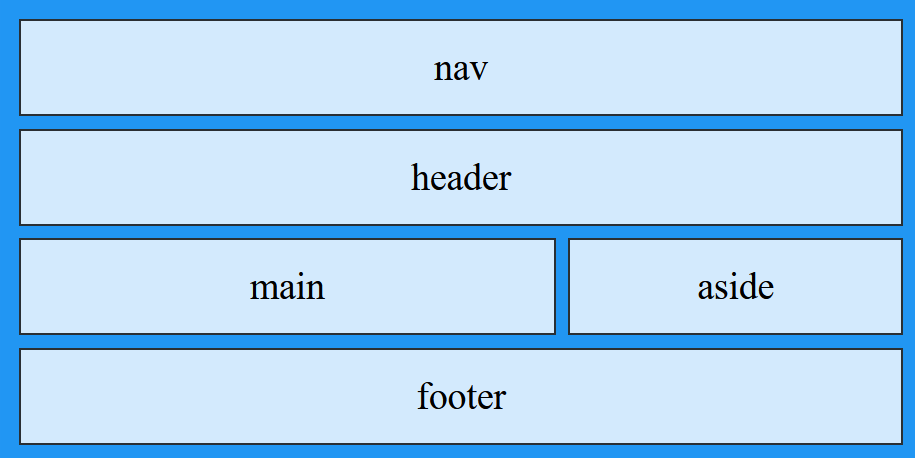

# Lab 6 Instructions

## Using CSS Grid and Flexbox

You will practice using Grid and Flexbox by applying them to the review web site you styled in Lab 5.

### Part 1: CSS Grid

Modify the external style sheet (.css file) for your site to use grid areas to control the layout of your review pages (just the reviews, not the home page).

1. Add a CSS rule to create a grid container element, which could be the `body`. This rule should contain a `grid-template-areas` property for the layout you want for all of your review pages. There should be at least 4 rows and three columns, and at least one row should have multiple items in it (for example, the main content and an aside side by side). This is one possible layout:

   

2. Add rules to the external style sheet that use the `grid-area` property to assign each element (such as `header`, `nav`, `main`, `aside`, and `footer`) to its area in the grid.

3. Apply the grid layout only to the review pages, not the home page. For example, put a class on the `body` element of each review page and use that class as the selector for the grid container rule.

### Part 2: Flexbox

Use flexbox containers to control the layout of these parts of your web pages:

1. The horizontal nav bar: arrange the links horizontally and control the spacing and alignment of the link items (for example, with `justify-content`, `align-items`, and `gap`).
2. Header: stack the items in the header vertically (`flex-direction: column`) and control the spacing and alignment.
3. Footer: arrange the items (text and/or symbols in spans) horizontally and control the spacing and alignment.

Put the CSS for this in the same external style sheet for the whole site so that it will be applied to all the pages, including the home page.

Check your pages using the <a href="https://validator.w3.org" target="_blank">W3C HTML Validator</a> and the <a href="https://jigsaw.w3.org/css-validator/" target="_blank">W3C CSS Validator</a>. Both should report no errors.

## Submission

#### Publishing to citstudent

- Use FileZilla to upload the folders containing your web site to citstudent.
  - Do <u>not</u> zip the files.
  - Since both parts 1 and 2 are in the same web site, you can just upload that one web site.
- Record the URL (web address) of your home page so that you can enter it in the "Online Text" box on Canvas.
  Hint: remember that *public_html* is <u>not</u> part of the URL. For example, if your home page is at *public_html/lab6/index.html*, the URL ends with */lab6/index.html*.

#### Submitting to Canvas

- Zip the folder containing your web site (both parts 1 and 2 are in one web site).

- Upload the zip file to Canvas.

- Enter the URL (web address) of your site's home page in the "Online Text" box for this assignment on  Canvas. This is important; without this, I won't be able to find your web page on the internet.

## Assessment

Your lab assignment will be assessed using [this rubric](Lab6Rubric-CIS195.htm).

------

 Web Authoring Lab Instructions by <a href="https://profbird.dev" target="_blank">Brian Bird</a>, written 2023, revised <time>2026</time>, are licensed under a <a href="http://creativecommons.org/licenses/by-sa/4.0/" target="_blank">Creative Commons Attribution-ShareAlike 4.0 International License</a>. 

------------

