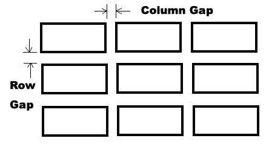
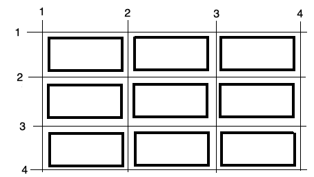

**CIS195 Web Authoring 1: HTML**

<h1>Using the CSS Grid for Layout</h1>

<h2>Contents</h2>

[TOC]

## Grid Container Elements

The CSS *grid* is used to position elements on a page. 

- The grid needs to be created inside some *container element*.  
- The container can be any block element like `div` or  `section`. But, note that `p` and `h1`&ndash;`h6` elements cannot contain a `div`.
- The `display: grid` or `display: inline-grid`  CSS property must be applied to the container. This is what makes the element a container for a grid!

  - The `grid-template-columns` property determines the width and number of columns.


For example, this HTML code:
```html
<div style="display: grid; grid-template-columns: auto auto auto;">
  <div>Item 1</div>
  <div>Item 2</div>
  <div>Item 3</div>  
  <div>Item 4</div>
  <div>Item 5</div>
  <div>Item 6</div>  
  <div>Item 7</div>
  <div>Item 8</div>
  <div>Item 9</div>  
</div>
```

Will be displayed like this on the web page:

Item 1						Item 2						Item 3  

Item 4						Item 5						Item 6  

Item 7						Item 8						Item 9  

Note that the three `auto` values in  `grid-template-columns: auto auto auto` are what specify the three columns and that their width is automatically determined.

## Grid Rows and Columns

- Columns: the number of columns and the width of each column are specified using the `grid-template-columns` property as seen above. It can have the following values:
  - `auto`:  the width is determined automatically.
  - `max-content`:  the width is determined by the widest item in the column.
  - `min-content`:  the width is determined by the narrowest item in the column.
  - numeric value:  any valid CSS width value with units including px, pt, in, em, fr, or %.
- Rows: the height is specified by the `grid-template-rows` property.
  - This property can have all the same values as those shown above.
  - If there are more rows than values, `grid-auto-rows` (default `auto`), will be applied to size the rest of the rows.

Example:

```html
<!-- in an embedded style sheet -->
  .container {
    display: grid; 
    grid-template-columns: 200px 200px 200px; 
    grid-template-rows: 50px 50px;
  }

<!-- in the body -->
<div class="container">
  <div>Item 1</div>
  <div>Item 2</div>
  <div>Item 3</div>  
  <div>Item 4</div>
  <div>Item 5</div>
  <div>Item 6</div>  
  <div>Item 7</div>
  <div>Item 8</div>
  <div>Item 9</div>  
</div>
```


## Grid Lines and Gaps

A gap is like a combination of padding and margin in the CSS box model; it's just the space between rows or columns. 

-  **Grid gaps** are set using one or more of these properties with any valid numeric length value:

  - `column-gap`: sets the width of the column gap.

  - `row-gap`: sets the height of the row gap.

  - `gap`: sets both the column and row gaps[^1].




- **Grid lines** are invisible lines that you can use to align things on your grid. They are numbered from left to right and from top to bottom.

  

An element can be made to span multiple columns using the column lines as a reference; for example:

  ```css
  .item2 {
    grid-column-start: 2;
    grid-column-end: 4;
  }
  ```

An element can be made to span multiple rows using the row lines as a reference; for example:

  ```CSS
  .item3 {
    grid-row-start: 2;
    grid-row-end: 4;
  }
  ```

We can apply these CSS rules like this:
```html
<div style="display: grid; grid-template-columns: auto auto auto;">
  <div>Item 1</div>
  <div class="item2">Item 2</div>
  <div class="item3">Item 3</div>  
  <div>Item 4</div>
  <div>Item 5</div>
  <div>Item 6</div>  
  <div>Item 7</div>
  <div>Item 8</div>
  <div>Item 9</div>  
</div>
```

Which will look like this on the web page:

Item 1						Item 2  

Item 3						Item 4						Item 5  

​									Item 6						Item 7

Item 8						Item 9  


## Grid Template Areas

The `grid-template-areas` property in CSS is used to position structural elements within a grid layout. Each element to be positioned must be given a `grid-area` name.  The `grid-template-areas` property is then used to arrange the named elements into rows and columns like this:

```html
<style>
    .container {
      display: grid;
      grid-template-areas:
        'header header header'
        'menu main sidebar'
        'section section sidebar'
        'footer footer footer';
    }
</style>

<div class="container">
    <header style="grid-area: header;">header</header>
    <nav style="grid-area: menu;">menu</nav>
    <main style="grid-area: main;">main</main>
    <section style="grid-area: section;">section</section>
    <aside style="grid-area: sidebar;">sidebar</aside>
    <footer style="grid-area: footer;">footer</footer>
  </div>
```

In this example, the `div` is a grid container with six named areas: `header`, `menu`, `main`, `section`, `sidebar` and `footer`. The `grid-template-areas` property draws a map of the layout, with one quoted string for each row. Each grid item is then assigned to an area with the `grid-area` property.

- **Position comes from the template, not the HTML order.** Each element goes wherever its `grid-area` name appears in the template. The order of the elements in the HTML source doesn’t change where they are placed.
- **Repeating a name makes an area span cells.** In the example, `header` spans all three columns of the first row, and `sidebar` spans the second and third rows of the last column.
  - **When spanning cells, each area must be a rectangle.** An L-shaped or split area is not valid, and the whole `grid-template-areas` value is ignored.
- **Every row must have the same number of cells.** Here, each string has three names, so the grid has three columns.
- **Use a period (`.`) for an empty cell.** For example, `'menu . sidebar'` leaves the middle cell empty.
- **Give each name to only one element.** If two elements share a name, they are placed in the same area and overlap.
- **Area names are your choice.** They don’t have to match the element names. For example, the `<nav>` element above is placed in the area named `menu`.


## Example Code

Open the example web page in your browser and use the *View Source* feature to look at the source code.

[CSS Grid Examples](../Examples/LayoutDemos/cssGridExample.html)


## Reference

<a href="https://www.w3schools.com/css/css_grid.asp" target="_blank">CSS Grid Tutorial</a> by W3schools  

<a href="https://flaviocopes.com/book/css/#31-css-grid" target="_blank">CSS Grid</a> in <a href="https://flaviocopes.com/book/css/" target="_blank">*The CSS Handbook*</a> by Flavio Copes

<a href="https://developer.mozilla.org/en-US/docs/Learn/CSS/CSS_layout/Grids" target="_blank">Grids</a> in <a href="https://developer.mozilla.org/en-US/" target="_blank">MDN Web Docs</a>


------

<a href="http://creativecommons.org/licenses/by-sa/4.0/" target="_blank"></a> Web Authoring Lecture Notes, written by <a href="https://profbird.dev" target="_blank">Brian Bird</a> in 2023 and revised in <time>2026</time>, are licensed under a <a href="http://creativecommons.org/licenses/by-sa/4.0/" target="_blank">Creative Commons Attribution-ShareAlike 4.0 International License</a>. 

[^1]: the older name `grid-gap` is now a legacy alias for `gap`.
